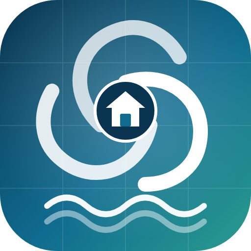

# Disaster Mapping & Relief Management System

A PHP 8 + MySQL 8 incident response and relief management application. It tracks incidents, affected families, warnings, shelter occupancy, field response tasks, partners, relief stock, and distribution. The **Live Report** combines warning signals, mapped incident paths, available shelter capacity, and relief coverage; the dashboard, interactive map, incident report, Data Health, inventory, and user administration support the wider response workflow.

## Submission package

- **`DRMS_Submission_Package.zip`** - complete final project files and companion documents.
- **`DRMS_Deep_System_Walkthrough.mp4`** - the original sign-in overview followed by the detailed feature walkthrough, in sequence; silent, with brief English visual callouts and no audio or subtitle track.
- **`DRMS_Detailed_Feature_Walkthrough.mp4`** - the detailed portion as a standalone video.
- **`DRMS_Submission_Guide.pdf`** - installation, detailed operator instructions, all 24 record pages, roles, data rules, testing, and troubleshooting.

See [`DRMS_Submission_Guide.md`](DRMS_Submission_Guide.md) for the complete text guide and test checklist.

## Run the application on Windows

1. Extract `DRMS_Submission_Package.zip`.
2. Copy the `disaster_and_relief_management` folder to `C:\wamp64\www\`.
3. In the application folder, copy `config.sample.php` to `config.php` and configure the local MySQL connection. An authorized first-run account needs permission to create the database, schema, and triggers.
4. Start WampServer and open `http://localhost/disaster_and_relief_management/`; or use `start_localhost.bat`.
5. On a fresh database, create the first administrator account. All included example data is fictional.

`start_server.bat` offers an alternative PHP development server on `http://127.0.0.1:8099/`. Do not expose this development server to the public internet.

Requirements: PHP 8.1+ with `mysqli` and `mbstring`; MySQL 8.0.16+; WampServer on Windows. Internet access is needed for OpenStreetMap map tiles and Ventusky weather.

## Project files

- [`disaster_and_relief_management/README.md`](disaster_and_relief_management/README.md) - application features, setup, security, tests, upgrades, and known limits.
- [`DRMS_Submission_Guide.md`](DRMS_Submission_Guide.md) - current operator guide and detailed acceptance checklist.
- [`DRMS_ER_Diagram.pdf`](DRMS_ER_Diagram.pdf) - original-schema diagram, explicitly not a complete representation of all current additions.
- [`PLAN.md`](PLAN.md) and [`TASKS.md`](TASKS.md) - project history and previously verified engineering work.
- `disaster_and_relief_management/tests/smoke.php` and `tests/concurrency.php` - database, business-rule, permission, and race-condition tests. Run them on a disposable test database only.

All demo data is fictional. For actual response use, use approved privacy controls, HTTPS, and a least-privilege database user; see the full guide.
